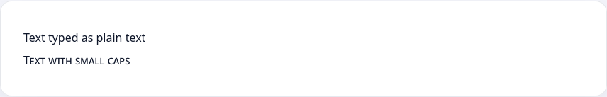

Small caps are a type of lowercase letter whose size is the same as (or close to) the size of capital letters.

```html
<p>Text typed as plain text</p>
<p class="small-caps">Text with small caps</p>
```

```css
.small-caps {
  font-variant: small-caps;
}
```



This is often used as a stylistic device. But there is also a practical side to small caps: they are commonly used to mark abbreviations, and they are also used in the first lines of a piece of text to make it easier for the reader to get into the text after the title.

To set small caps, use the `font-variant` property with one of two basic values:

- `normal` - normal writing
- `small-caps` - small caps

Small caps depend on the font and the browser. If the font has no small-cap glyphs, the browser draws scaled-down capitals or leaves the text as is. For example, Firefox on Linux with the default font renders Latin text in small caps but leaves Cyrillic text in regular lowercase.
