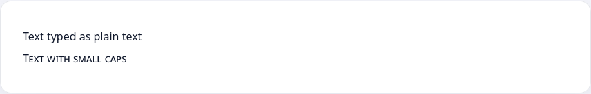

La capital es un tipo de letras minúsculas cuyo tamaño coincide (o se aproxima) al tamaño de las letras mayúsculas.

```html
<p>Text typed as plain text</p>
<p class="small-caps">Text with small caps</p>
```

```css
.small-caps {
  font-variant: small-caps;
}
```



A menudo, esta forma de escritura se utiliza como recurso estilístico. Sin embargo, también tiene un propósito práctico: se utiliza para abreviaturas y en las primeras líneas de una obra para facilitar la transición del lector al texto después del título.

Para aplicar la letra capital, se utiliza la propiedad `font-variant` con uno de los dos valores principales:

- `normal` — escritura normal del texto
- `small-caps` — capital

La versalita depende de la fuente y del navegador. Si la fuente no tiene versalitas, el navegador dibuja mayúsculas reducidas o deja el texto como está. Por ejemplo, Firefox en Linux con la fuente predeterminada muestra el texto latino en versalitas, pero deja el cirílico en minúsculas normales.
